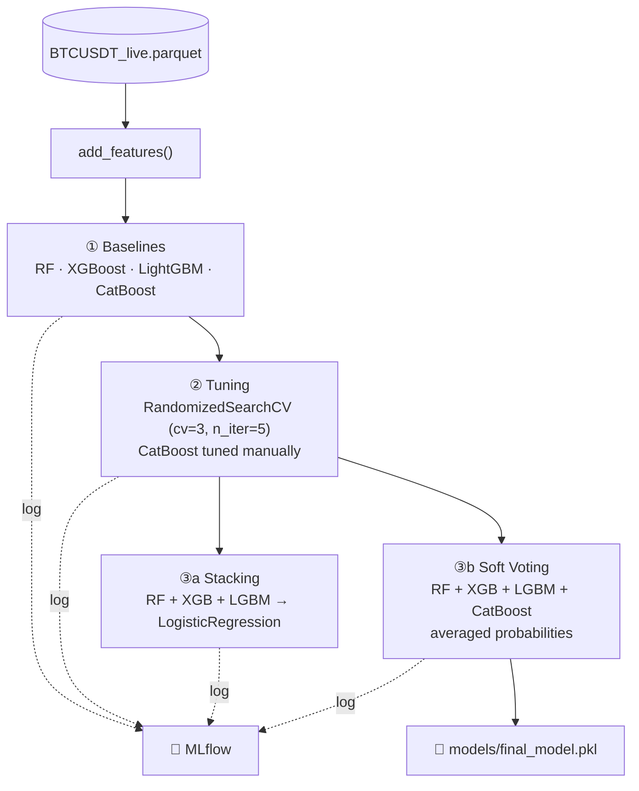
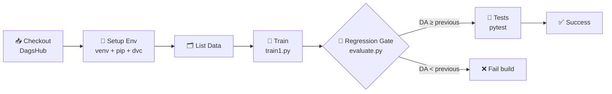

<div align="center">

# ₿ Crypto MLOps

### Real-time BTC/USDT candle-direction prediction, from data stream to production

*Binance WebSocket → Kafka → Feature Engineering → Ensemble ML → FastAPI → Streamlit, wired up with MLflow, DVC, Jenkins, Prometheus, Grafana & Kubernetes*

<br/>


<br/>

[Overview](#-overview) •
[Architecture](#️-architecture) •
[Features](#-feature-engineering) •
[Models](#-modeling) •
[Quick Start](#-quick-start) •
[API](#-api-reference) •
[CI/CD](#-cicd-pipeline) •
[Monitoring](#-monitoring)

</div>

---

## 🔭 Overview

**Crypto MLOps** is an end-to-end machine learning system that predicts whether the **next 1-minute BTC/USDT candle will close UP or DOWN**.

It covers the whole ML lifecycle, not just the model:

| Stage | What happens |
|:--|:--|
| 📡 **Ingest** | Live 1-minute klines streamed from the Binance WebSocket into a Kafka topic |
| 🧮 **Process** | 13 candlestick and technical features computed in real time |
| 🧠 **Train** | RandomForest, XGBoost, LightGBM and CatBoost, tuned and ensembled |
| 📒 **Track** | Every run, parameter, metric and model logged to MLflow on DagsHub |
| 🗃️ **Version** | Datasets versioned with DVC (DagsHub remote) |
| 🚦 **Gate** | Jenkins fails the build if Directional Accuracy drops vs. the previous run |
| 🚀 **Serve** | FastAPI REST and SSE streaming endpoints, containerized and deployed on Kubernetes |
| 📊 **Observe** | Prometheus metrics scraped and visualized in Grafana, live Streamlit dashboard |

---

## 🏗️ Architecture

```mermaid
flowchart LR
    subgraph SRC["📡 Data Sources"]
        BWS["Binance WebSocket<br/><code>btcusdt@kline_1m</code>"]
        BREST["Binance REST<br/>historical klines"]
    end

    subgraph STREAM["⚡ Streaming"]
        PROD["binance_producer.py"]
        KAFKA[("Kafka<br/><code>btc_klines</code>")]
        CONS["kafka_consumer_stream.py"]
    end

    subgraph DATA["🗃️ Data Layer · DVC"]
        RAW[("data/raw<br/>BTCUSDT_1m.csv")]
        PROC[("data/processed<br/>BTCUSDT_live.parquet")]
    end

    subgraph ML["🧠 Training"]
        FE["transforms.py<br/>feature engineering"]
        TRAIN["train1.py<br/>RF · XGB · LGBM · CatBoost"]
        ENS["Soft-Voting Ensemble<br/><code>final_model.pkl</code>"]
    end

    subgraph TRACK["📒 Tracking"]
        MLF["MLflow @ DagsHub"]
    end

    subgraph SERVE["🚀 Serving · Kubernetes"]
        API["FastAPI<br/>:8000 / :30000"]
        UI["Streamlit<br/>:8501 / :30001"]
    end

    subgraph OBS["📊 Observability"]
        PROM["Prometheus<br/>:30900"]
        GRAF["Grafana<br/>:3000"]
    end

    BWS --> PROD --> KAFKA --> CONS
    BREST --> RAW --> CONS
    CONS --> PROC
    CONS -. live metrics .-> MLF
    PROC --> FE --> TRAIN --> ENS
    TRAIN -. runs & metrics .-> MLF
    ENS --> API
    API --> UI
    API -- /metrics --> PROM --> GRAF
```



---

## 📁 Project Structure

```text
crypto-mlops/
├── src/
│   ├── ingestion/
│   │   ├── binance_producer.py        # Binance WebSocket → Kafka producer
│   │   └── historical_fetch.py        # Bootstrap historical 1m candles (REST)
│   ├── consumers/
│   │   ├── kafka_consumer.py          # Basic Kafka consumer
│   │   └── kafka_consumer_stream.py   # Live features + predictions + MLflow logging
│   ├── processing/
│   │   ├── transforms.py              # Training & real-time feature engineering
│   │   └── indicators.py              # Technical indicators (RSI, …)
│   ├── models/
│   │   └── train1.py                  # Baselines → tuning → ensembles
│   └── api/
│       ├── app.py                     # FastAPI: /health, /predict, /stream, /metrics
│       ├── model_loader.py            # Model + feature loading, inference helpers
│       └── metrics.py                 # Standalone Prometheus metrics API
├── dashboard/app.py                   # Streamlit dashboard (Altair charts)
├── crypto_dashboard.py                # Streamlit dashboard (container image)
├── tests/test_app.py                  # Async API tests (pytest + httpx)
├── evaluate.py                        # Performance regression gate
├── models/                            # Serialized models (*.pkl)
├── data/                              # DVC-tracked datasets
├── config/logging.yaml
├── Dockerfile                         # API image
├── Dockerfile.front                   # Dashboard image
├── docker-compose.yml
├── crypto-api-deployment.yaml         # K8s: API Deployment + NodePort Service
├── crypto-dashboard-deployment.yaml   # K8s: Dashboard
├── prometheus-deployment.yaml         # K8s: Prometheus
├── grafana-deployment.yaml            # K8s: Grafana
├── Jenkinsfile                        # CI/CD pipeline
└── requirements.txt
```

---

## 🧮 Feature Engineering

All features are derived from raw OHLCV candles in [`src/processing/transforms.py`](src/processing/transforms.py). There are two variants: `add_features()` for batch training and `add_features_realtime()` for the stream, which uses `min_periods=1` so it works on short windows.

<table>
<tr><th>Category</th><th>Feature</th><th>Definition</th></tr>
<tr><td rowspan="5">🕯️ <b>Candle shape</b></td>
    <td><code>HL_range</code></td><td>high − low</td></tr>
<tr><td><code>OC_change</code></td><td>close − open</td></tr>
<tr><td><code>OC_pct_change</code></td><td>(close − open) / open × 100</td></tr>
<tr><td><code>candle_body</code></td><td>|close − open|</td></tr>
<tr><td><code>candle_direction</code></td><td>+1 bullish / −1 bearish</td></tr>
<tr><td rowspan="2">🌗 <b>Wicks</b></td>
    <td><code>upper_shadow</code></td><td>high − max(open, close)</td></tr>
<tr><td><code>lower_shadow</code></td><td>min(open, close) − low</td></tr>
<tr><td rowspan="2">📦 <b>Volume / Momentum</b></td>
    <td><code>volume_ratio</code></td><td>volume / rolling-5 mean volume</td></tr>
<tr><td><code>price_change_5</code></td><td>close − close<sub>t−5</sub></td></tr>
<tr><td rowspan="4">📈 <b>Trend</b></td>
    <td><code>MA_5</code>, <code>MA_10</code></td><td>Simple moving averages</td></tr>
<tr><td><code>EMA_10</code></td><td>Exponential moving average (span 10)</td></tr>
<tr><td><code>VWAP</code></td><td>Typical price × volume / rolling-5 volume</td></tr>
</table>

🎯 **Target:** `1` if `close[t+1] > close[t]`, else `0`.

---

## 🧠 Modeling

Training lives in [`src/models/train1.py`](src/models/train1.py) and uses a **chronological 80/20 split** (no shuffling, so no look-ahead leakage).



### 📏 Evaluation metrics

| Metric | Meaning |
|:--|:--|
| **DA** (Directional Accuracy) | Share of candles whose direction was predicted correctly |
| **Precision_Up** | Precision on UP predictions |
| **Precision_Down** | Precision on DOWN predictions |
| **PnL** | Simulated return of going long on UP and short on DOWN |

Every model variant is saved to `models/` and logged to MLflow under the experiment **`crypto_candle_prediction`**:

```
RandomForest_{baseline,tuned}.pkl   XGBoost_{baseline,tuned}.pkl
LightGBM_{baseline,tuned}.pkl       CatBoost_{baseline,tuned}.pkl
Stacking_ensemble.pkl               ManualVotingEnsemble_ensemble.pkl
final_model.pkl  ⭐
```

---

## 🚀 Quick Start

### 1️⃣ Prerequisites

- Python **3.11**
- Docker & Docker Compose
- A running **Kafka** broker on `localhost:9092` (for live streaming)
- *(optional)* Kubernetes (Docker Desktop), plus a DagsHub account for remote MLflow/DVC

### 2️⃣ Install

```bash
git clone https://dagshub.com/Ouma122456/crypto_mlops.git
cd crypto_mlops

python -m venv .venv
source .venv/bin/activate          # Windows: .venv\Scripts\activate
pip install -r requirements.txt
```

### 3️⃣ Configure

Create a `.env` file at the project root:

```env
DAGSHUB_USERNAME=<your-username>
DAGSHUB_REPO_NAME=crypto_mlops
DAGSHUB_TOKEN=<your-token>
```

> 💡 If these are not set, MLflow falls back to a local `./mlruns` store.

### 4️⃣ Pull the data

```bash
dvc pull
```

### 5️⃣ Run the pipeline

```bash
# Bootstrap historical candles
python src/ingestion/historical_fetch.py

# Terminal A: stream live Binance klines into Kafka
python src/ingestion/binance_producer.py

# Terminal B: consume, engineer features, predict, write parquet
python -m src.consumers.kafka_consumer_stream

# Train all models and build the ensemble
python -m src.models.train1

# Check the newest run for a performance regression
python evaluate.py
```

### 6️⃣ Serve it

<details open>
<summary><b>🐳 Docker Compose</b></summary>

```bash
docker compose up --build
```

| Service | URL |
|:--|:--|
| FastAPI | http://localhost:8000/docs |
| Streamlit | http://localhost:8501 |

</details>

<details>
<summary><b>☸️ Kubernetes (Docker Desktop)</b></summary>

```bash
docker build -t crypto-api:latest -f Dockerfile .
docker build -t crypto-mlops-front:latest -f Dockerfile.front .

kubectl apply -f crypto-api-deployment.yaml
kubectl apply -f crypto-dashboard-deployment.yaml
kubectl apply -f prometheus-deployment.yaml
kubectl apply -f grafana-deployment.yaml
```

| Service | NodePort |
|:--|:--|
| FastAPI | http://localhost:30000 |
| Streamlit | http://localhost:30001 |
| Prometheus | http://localhost:30900 |
| Grafana | port `3000` |

> ⚠️ The manifests mount `models/` and `data/processed/` via `hostPath` (`/run/desktop/mnt/host/d/crypto-mlops/...`). Change these paths to match your machine.

</details>

<details>
<summary><b>🐍 Local (no containers)</b></summary>

```bash
uvicorn src.api.app:app --reload --port 8000
streamlit run dashboard/app.py
```

</details>

---

## 🔌 API Reference

Base URL: `http://localhost:8000`. Interactive docs are at **`/docs`** (Swagger UI).

| Method | Endpoint | Description |
|:--:|:--|:--|
| `GET` | `/health` | Liveness probe, returns `{"status": "ok"}` |
| `GET` | `/predict` | Latest UP/DOWN prediction |
| `GET` | `/stream?interval=1.0&max_events=N` | Server-Sent Events stream of predictions |
| `GET` | `/metrics` | Prometheus metrics |

**Example response for `/predict`:**

```json
{
  "price": 87123.45,
  "prediction": 1,
  "prediction_label": "UP",
  "probability": 0.72,
  "timestamp": 1730419200000
}
```

**Stream live predictions:**

```bash
curl -N "http://localhost:8000/stream?interval=1"
```

> 📝 **Note:** `src/api/app.py` currently serves **simulated** predictions so the API, dashboard and monitoring stack can be demoed without a model. Inference on the real trained model is implemented in [`src/api/model_loader.py`](src/api/model_loader.py) (`load_model`, `make_prediction_from_df`).

---

## 🔁 CI/CD Pipeline

Defined in the [`Jenkinsfile`](Jenkinsfile) and triggered from the DagsHub repository.



### 🚦 Performance regression gate

[`evaluate.py`](evaluate.py) pulls the **two most recent MLflow runs** and compares their **Directional Accuracy**. If the new model is worse, the script exits with code `1` and the pipeline stops before the model can ship.

```text
Latest DA: <latest>
Previous DA: <previous>
Model performance improved or stable     # exit 0, or:
Performance regression detected          # exit 1, build fails
```

---

## 📊 Monitoring

The API exposes Prometheus metrics at `/metrics`:

| Metric | Type | Labels | Description |
|:--|:--:|:--|:--|
| `api_requests_total` | Counter | `endpoint`, `status` | Total HTTP requests |
| `api_request_latency_seconds` | Histogram | `endpoint` | Request latency |
| `crypto_predictions_up_total` | Counter | none | Number of UP predictions |
| `crypto_predictions_down_total` | Counter | none | Number of DOWN predictions |

Prometheus scrapes the API, and Grafana visualizes traffic, latency percentiles and the UP/DOWN prediction balance.

**Useful PromQL:**

```promql
# Requests per second by endpoint
sum by (endpoint) (rate(api_requests_total[1m]))

# p95 latency
histogram_quantile(0.95, sum by (le) (rate(api_request_latency_seconds_bucket[5m])))

# Share of UP predictions
rate(crypto_predictions_up_total[5m])
  / (rate(crypto_predictions_up_total[5m]) + rate(crypto_predictions_down_total[5m]))
```

The streaming consumer also writes a heartbeat to `data/stream_heartbeat.txt` so you can check that the stream is still alive.

---

## 🧪 Testing

```bash
pytest -v tests/test_app.py
```

The tests cover `/health`, `/predict` (schema and value ranges), the `/stream` SSE endpoint and the `predict_latest()` helper, using `httpx.AsyncClient` with `ASGITransport`.

---

## 🛠️ Tech Stack

<table>
<tr>
<td align="center" width="25%"><b>Data & Streaming</b><br/><br/>Binance API<br/>WebSocket<br/>Apache Kafka<br/>Pandas · PyArrow</td>
<td align="center" width="25%"><b>Machine Learning</b><br/><br/>scikit-learn<br/>XGBoost<br/>LightGBM<br/>CatBoost</td>
<td align="center" width="25%"><b>MLOps</b><br/><br/>MLflow<br/>DVC<br/>DagsHub<br/>Jenkins</td>
<td align="center" width="25%"><b>Serving & Ops</b><br/><br/>FastAPI · Uvicorn<br/>Streamlit · Altair<br/>Docker · Kubernetes<br/>Prometheus · Grafana</td>
</tr>
</table>

---

## 🗺️ Roadmap

- [ ] Serve real `final_model.pkl` predictions from `/predict` instead of the simulated ones
- [ ] Move Kafka, MLflow and other config into environment variables / `config/`
- [ ] Add Kafka and Zookeeper to `docker-compose.yml`
- [ ] Build images and deploy to Kubernetes automatically in Jenkins
- [ ] Monitor data and model drift (e.g. Evidently)
- [ ] Support more trading pairs (ETH/USDT, SOL/USDT, …)
- [ ] Ship provisioned Grafana dashboards as code

---

## ⚠️ Disclaimer

This project is for **educational and research purposes only**. It is **not financial advice**. Crypto markets are extremely volatile, and short-horizon price direction is notoriously hard to predict. Do not trade real money based on this model.

---

<div align="center">

**Built with ☕ and 📈 by [Oumayma Abassi](https://dagshub.com/Ouma122456)**

⭐ If you find this project useful, consider giving it a star!

</div>
